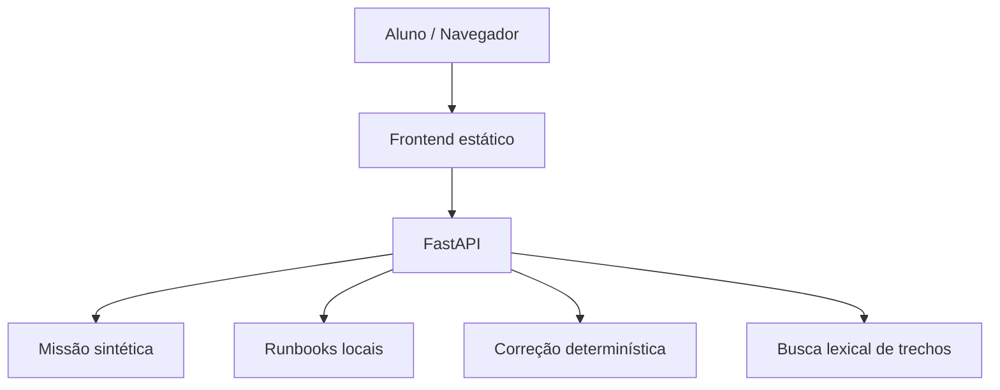

# Arquitetura — versão 0.1

**Implementado:** API sem estado, dados sintéticos versionados, layout responsivo, consulta de runbooks e avaliação das cinco questões após envio.

**Não implementado:** usuários, banco persistente, LLM, embeddings, banco vetorial, RAG semântico, painel administrativo, sete dias completos ou prova de 65 questões.

## Visão futura do AI Incident Mentor

1. Ingerir conteúdo aprovado de apostilas e runbooks, com metadados.
2. Segmentar documentos, gerar embeddings e indexar base vetorial.
3. Recuperar trechos relevantes e alimentar um LLM com política de resposta e citações.
4. Avaliar recuperações e respostas em conjunto de incidentes sintéticos.
5. Proibir exposição de segredos e atuação direta sobre sistemas reais.
6. Desabilitar tutor no simulado final; manter aprovação com critérios determinísticos.

O sistema educacional deve permanecer operacional quando a API do modelo estiver indisponível.
